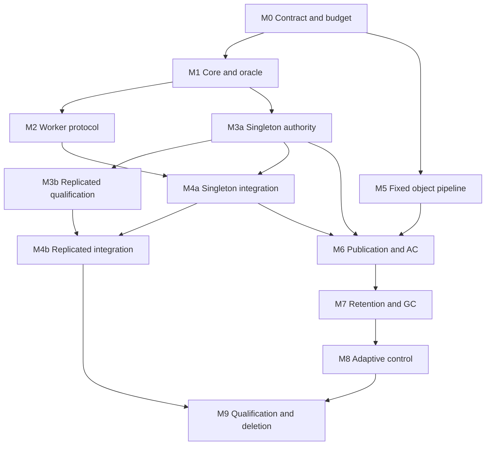

Draft 0.3 — 22 October 2026

This plan replaces NativeLink's independently configurable scheduler and storage behaviors with one executable contract. The immediate upstream deliverable is an OpenRaftScheduler with the Trinity-inspired transition semantics defined below. M4a delivers singleton-durable integration and scheduler-owned accepted-result publication; M4b qualifies the identical implementation with replicated authority. The completed program removes Redis, scheduler composition, a separately mutable AC payload store, and the recursive store topology language.

The implementation advances through reviewable changes with executable acceptance gates. The first Astra assignment is M0's scheduler contract and shared-authority sizing work plus the bounded M1 lifecycle. Model and harness work can begin while measurements are gathered; production state and persistence formats cannot freeze before the M0 budget gate.

# Fixed objectives

These are user decisions. An implementation agent may choose representations and improve algorithms within them; it may not relax them to get a test or migration to pass.

1. One scheduler implementation and one authoritative transition model. There is no scheduler composition, scheduler plugin selection, or backend-specific scheduler semantics.

2. One deterministic transition over authoritative state and recorded input produces updated state, reply data, and durable effect intents. External observations reenter as explicit events.

3. The singleton uses the same proposal, commit, apply, and effect path as a replicated deployment. Volatile and durable authority storage implement the same interface and logical rules, with explicitly different recovery envelopes.

4. Redis is removed permanently from the final product: scheduler authority, CAS and AC backends, notifications, discovery, projections, fallbacks, runtime dependencies, and supported deployment artifacts.

5. AC is a derived lookup view over accepted immutable publications into the CAS graph. There is no separately mutable AC payload store.

6. Store topology has a fixed normal form with explicitly qualified physical implementations and transport roles. Users cannot recursively assemble verification, caching, retry, sharding, deduplication, compression, and persistence semantics. The topology disposition table names the capabilities that remain and the deployment shapes that are retired.

7. Scheduler behavior has no operator policy selectors. Node count is the remaining scheduler topology choice. Identities, endpoints, credentials, resource quantities, and request requirements are deployment facts, not alternate algorithms. The canonical runtime rejects legacy `stores` and `schedulers` blocks; a separate offline migration tool produces a candidate configuration and placement diff.

8. Workload variance is handled by bounded admission, backpressure, and one implementation-owned control policy.

9. Verification includes an independent reference model, adversarial event schedules, bounded exhaustive exploration, mutation tests, deterministic replay, and real protocol fault injection.

10. Completion includes deletion of superseded implementations and configuration semantics. Adding another implementation is an intermediate construction step.

Client-facing REAPI behavior remains a compatibility target. The named customer-facing reductions below explicitly identify retired deployment layouts and diagnostic integrations. Internal worker messages may change where attempt identity and reconciliation require it. A new scheduler cannot promise stronger identity guarantees while silently accepting an older unfenced worker protocol.

# Scope and evidence baseline

The inspected public-upstream baseline is [TraceMachina NativeLink commit a7bb376e6f66284eb37a77b22d2f258c03ba9a7f](https://github.com/TraceMachina/nativelink/commit/a7bb376e6f66284eb37a77b22d2f258c03ba9a7f). The source map was checked against that tree. The executing agent must record the actual checkout, HEAD, branch, local changes, repository instructions, dependency versions, and build commands before editing. Differences from this baseline become entries in the source map. The linked pinned REAPI definitions are the compatibility baseline; any deliberate schema update is recorded separately.

| Responsibility | Pinned sources | Work it informs |
| - | - | - |
| Configuration and recursive construction | [schedulers.rs](https://github.com/TraceMachina/nativelink/blob/a7bb376e6f66284eb37a77b22d2f258c03ba9a7f/nativelink-config/src/schedulers.rs), [stores.rs](https://github.com/TraceMachina/nativelink/blob/a7bb376e6f66284eb37a77b22d2f258c03ba9a7f/nativelink-config/src/stores.rs), [default_scheduler_factory.rs](https://github.com/TraceMachina/nativelink/blob/a7bb376e6f66284eb37a77b22d2f258c03ba9a7f/nativelink-scheduler/src/default_scheduler_factory.rs), [default_store_factory.rs](https://github.com/TraceMachina/nativelink/blob/a7bb376e6f66284eb37a77b22d2f258c03ba9a7f/nativelink-store/src/default_store_factory.rs) | Map all five scheduler variants and all eighteen store variants to fixed roles or explicit removal. |
| Scheduler/client/worker boundary | [simple_scheduler.rs](https://github.com/TraceMachina/nativelink/blob/a7bb376e6f66284eb37a77b22d2f258c03ba9a7f/nativelink-scheduler/src/simple_scheduler.rs), [simple_scheduler_state_manager.rs](https://github.com/TraceMachina/nativelink/blob/a7bb376e6f66284eb37a77b22d2f258c03ba9a7f/nativelink-scheduler/src/simple_scheduler_state_manager.rs), [api_worker_scheduler.rs](https://github.com/TraceMachina/nativelink/blob/a7bb376e6f66284eb37a77b22d2f258c03ba9a7f/nativelink-scheduler/src/api_worker_scheduler.rs), [worker_registry.rs](https://github.com/TraceMachina/nativelink/blob/a7bb376e6f66284eb37a77b22d2f258c03ba9a7f/nativelink-scheduler/src/worker_registry.rs) | Inventory state mutation, dispatch, result acceptance, incarnation, and reclamation seams. |
| Scheduler state and Redis backend | [store_awaited_action_db.rs](https://github.com/TraceMachina/nativelink/blob/a7bb376e6f66284eb37a77b22d2f258c03ba9a7f/nativelink-scheduler/src/store_awaited_action_db.rs), [memory_awaited_action_db.rs](https://github.com/TraceMachina/nativelink/blob/a7bb376e6f66284eb37a77b22d2f258c03ba9a7f/nativelink-scheduler/src/memory_awaited_action_db.rs), [awaited_action_db/mod.rs](https://github.com/TraceMachina/nativelink/blob/a7bb376e6f66284eb37a77b22d2f258c03ba9a7f/nativelink-scheduler/src/awaited_action_db/mod.rs), [awaited_action.rs](https://github.com/TraceMachina/nativelink/blob/a7bb376e6f66284eb37a77b22d2f258c03ba9a7f/nativelink-scheduler/src/awaited_action_db/awaited_action.rs) | Replace both state realizations with one authority model; explicitly remove the Redis scheduler backend. |
| Eligibility, impossible requests, and placement | [worker_capability_index.rs](https://github.com/TraceMachina/nativelink/blob/a7bb376e6f66284eb37a77b22d2f258c03ba9a7f/nativelink-scheduler/src/worker_capability_index.rs), [unsatisfiable_tracker.rs](https://github.com/TraceMachina/nativelink/blob/a7bb376e6f66284eb37a77b22d2f258c03ba9a7f/nativelink-scheduler/src/unsatisfiable_tracker.rs), [match_outcome.rs](https://github.com/TraceMachina/nativelink/blob/a7bb376e6f66284eb37a77b22d2f258c03ba9a7f/nativelink-scheduler/src/match_outcome.rs), [platform_property_manager.rs](https://github.com/TraceMachina/nativelink/blob/a7bb376e6f66284eb37a77b22d2f258c03ba9a7f/nativelink-scheduler/src/platform_property_manager.rs) | Give retained correctness rules fixed owners; preserve diagnosable unsatisfiable requests and bounded placement work. |
| Existing policy wrappers | [historical_resource_scheduler.rs](https://github.com/TraceMachina/nativelink/blob/a7bb376e6f66284eb37a77b22d2f258c03ba9a7f/nativelink-scheduler/src/historical_resource_scheduler.rs), [cache_lookup_scheduler.rs](https://github.com/TraceMachina/nativelink/blob/a7bb376e6f66284eb37a77b22d2f258c03ba9a7f/nativelink-scheduler/src/cache_lookup_scheduler.rs), [property_modifier_scheduler.rs](https://github.com/TraceMachina/nativelink/blob/a7bb376e6f66284eb37a77b22d2f258c03ba9a7f/nativelink-scheduler/src/property_modifier_scheduler.rs), [grpc_scheduler.rs](https://github.com/TraceMachina/nativelink/blob/a7bb376e6f66284eb37a77b22d2f258c03ba9a7f/nativelink-scheduler/src/grpc_scheduler.rs) | Delete composition; fold useful history into M8 estimators and cache behavior into the fixed request path; retire scheduler federation. |
| Worker publication and transfer | [local_worker.rs](https://github.com/TraceMachina/nativelink/blob/a7bb376e6f66284eb37a77b22d2f258c03ba9a7f/nativelink-worker/src/local_worker.rs#L724), [running_actions_manager.rs](https://github.com/TraceMachina/nativelink/blob/a7bb376e6f66284eb37a77b22d2f258c03ba9a7f/nativelink-worker/src/running_actions_manager.rs#L4766), [UploadActionResultConfig](https://github.com/TraceMachina/nativelink/blob/a7bb376e6f66284eb37a77b22d2f258c03ba9a7f/nativelink-config/src/cas_server.rs#L1087), [worker CAS requirements](https://github.com/TraceMachina/nativelink/blob/a7bb376e6f66284eb37a77b22d2f258c03ba9a7f/nativelink-config/src/cas_server.rs#L1484) | Move AC and accepted historical publication after scheduler acceptance; retain filesystem materialization/hardlinks and CAS gateway transport. |
| Listener and publication boundary | [AC update handler](https://github.com/TraceMachina/nativelink/blob/a7bb376e6f66284eb37a77b22d2f258c03ba9a7f/nativelink-service/src/ac_server.rs#L121), [listener service sets](https://github.com/TraceMachina/nativelink/blob/a7bb376e6f66284eb37a77b22d2f258c03ba9a7f/nativelink-config/src/cas_server.rs#L737), [service mounting](https://github.com/TraceMachina/nativelink/blob/a7bb376e6f66284eb37a77b22d2f258c03ba9a7f/src/bin/nativelink.rs#L321), [listener mTLS](https://github.com/TraceMachina/nativelink/blob/a7bb376e6f66284eb37a77b22d2f258c03ba9a7f/src/bin/nativelink.rs#L593) | M4a uses fixed worker/client listeners and existing trust/network exclusion. The baseline handler has an instance read-only check, not a worker-versus-client authorization layer. |
| Request cacheability | [action_messages.rs](https://github.com/TraceMachina/nativelink/blob/a7bb376e6f66284eb37a77b22d2f258c03ba9a7f/nativelink-util/src/action_messages.rs#L328), [execution_server.rs](https://github.com/TraceMachina/nativelink/blob/a7bb376e6f66284eb37a77b22d2f258c03ba9a7f/nativelink-service/src/execution_server.rs#L265), [pinned REAPI schema](https://github.com/TraceMachina/nativelink/blob/a7bb376e6f66284eb37a77b22d2f258c03ba9a7f/nativelink-proto/build/bazel/remote/execution/v2/remote_execution.proto) | Separate skip_cache_lookup from Action.do_not_cache; do not preserve their current conflation in the oracle. |
| Redis dependency closure | [nativelink-error/Cargo.toml](https://github.com/TraceMachina/nativelink/blob/a7bb376e6f66284eb37a77b22d2f258c03ba9a7f/nativelink-error/Cargo.toml#L26), [nativelink-error/BUILD.bazel](https://github.com/TraceMachina/nativelink/blob/a7bb376e6f66284eb37a77b22d2f258c03ba9a7f/nativelink-error/BUILD.bazel), [RedisError conversion](https://github.com/TraceMachina/nativelink/blob/a7bb376e6f66284eb37a77b22d2f258c03ba9a7f/nativelink-error/src/lib.rs#L329), [scheduler manifest](https://github.com/TraceMachina/nativelink/blob/a7bb376e6f66284eb37a77b22d2f258c03ba9a7f/nativelink-scheduler/Cargo.toml) | Remove shared error conversions, Cargo and Bazel dependencies, lockfile closure, Redis helper/test wiring, and scheduler/store constructors. |
| Existing Azure implementation | [ExperimentalAzureSpec](https://github.com/TraceMachina/nativelink/blob/a7bb376e6f66284eb37a77b22d2f258c03ba9a7f/nativelink-config/src/stores.rs#L1323), [azure_blob_store.rs](https://github.com/TraceMachina/nativelink/blob/a7bb376e6f66284eb37a77b22d2f258c03ba9a7f/nativelink-store/src/azure_blob_store.rs), [Azure tests](https://github.com/TraceMachina/nativelink/blob/a7bb376e6f66284eb37a77b22d2f258c03ba9a7f/nativelink-store/tests/azure_blob_store_test.rs), [Azurite tests](https://github.com/TraceMachina/nativelink/blob/a7bb376e6f66284eb37a77b22d2f258c03ba9a7f/nativelink-store/tests/azurite_store_test.rs) | Adapt and certify existing code against the new physical-generation, acknowledgment, and retention contract. |
| Architectural motivation | [Ownership appendix](https://shannon.osiris-walleye.ts.net:8443/appendix/scheduler-ownership.html) | Treat its claims as inputs to executable definitions, subject to the supersessions below. |

The appendix's physical at-most-one-executor claim, equivalence between assignment and worker notification, unconditional failure-detection bounds, and Redis-backed log option are superseded by the contracts below. OpenRaft 0.9.25 is fixed by this draft; M0 verifies the pinned storage/read requirements and the selected durable adapter, rather than choosing a version.

This program does not include a language rewrite, new transport stack, new build system, new peer-replicated CAS, or a general-purpose consensus implementation. Existing Lean models and rechaos are useful inputs after their actual interfaces and coverage are inspected. They must not become unverified assumptions or prerequisites that stall the first Rust implementation.

# Proposed architecture

## Authority and effects

Use one ordered metadata authority for execution decisions and, as the later stages land, publication acceptance and retention transitions. Keep modules separate internally. Blob transfer, hash computation, graph traversal, and index construction run outside the transition function; their observations enter through identity-bearing events.

The following is a logical interface, not a declaration of existing repository APIs:

```rust
fn step(state: State, event: RecordedEvent) -> Transition {
    // Transition contains the next state, reply, and ordered effect intents.
}
```

The core does not read clocks, generate randomness, perform I/O, spawn tasks, consult environment variables, or depend on unordered collection iteration. Allocation of IDs, policy revisions, time observations, and relevant external completions is explicit and replayable. Production data structures may be efficient; canonical comparison and serialization must remain deterministic.

The transition function applies a committed event. Pending effects are installed atomically with the resulting authoritative state; returned intents describe that outbox rather than creating a second effect source. Pre-proposal work performs bounded syntax, identity, authorization, and size validation and prepares immutable inputs; every state-dependent acceptance condition is revalidated during committed application. It cannot dispatch work or issue an acceptance reply. The M1 harness models proposal, commit, and application explicitly without implementing Raft. M9 shadow evaluation uses the same reducer on isolated recorded state with external effects and accepted replies disabled; there is no second evaluation engine.

The replicated state contains pending effects. An effect driver acts only on committed intents and reports outcomes using stable effect identities. A crash between an external action and recording its result leaves an uncertain effect, which recovery reconciles or retries with the same logical identity. Local channels and notifications are hints, never authoritative history.

Healthy attempts need not change identity on a Raft election. Leadership, attempt authority, worker incarnation, and transport connectivity are separate facts. A delayed message from an old leader may still arrive; recipient deduplication and current-attempt validation must make it harmless to authoritative state.

## Required identities

| Identity | Purpose |
| - | - |
| Cluster epoch | Separates a valid authority lineage from a deliberate fresh cluster. |
| Qualified action key | Namespace or instance, digest function, and action digest; used only where coalescing and cache lookup are permitted. |
| Execution ID | One scheduled execution, possibly shared by compatible client operations. Noncacheable submissions receive separate executions. |
| Operation ID | A client's observable execution handle, with a stable terminal result. |
| Attempt ID | One attempt within an execution; independent of Raft term. |
| Worker ID and incarnation | Logical worker and a particular process lifetime with reconciled capacity. |
| Transport session | A reconnectable communication channel; reconnect does not by itself create a new incarnation. |
| Reservation ID | The original charged resource vector and its release/quarantine state. |
| Effect ID | A stable identifier for dispatch, cancellation, deletion, or another external intent. |
| Publication and staging IDs | An accepted immutable result relation and its invisible preparation state. |
| Object ID and physical generation | Content identity and the exact physical incarnation affected by a write or deletion; locators include a nonreused store/cluster incarnation so an empty recovered catalogue cannot reuse them. |

Use distinct types. Do not substitute OperationId for AttemptId or use timestamps as fencing tokens.

### Glossary

**Trinity-inspired transition** names this plan's adopted semantics: a deterministic transition from authoritative state and recorded input to updated state, reply data, and durable effect intents. External observations return as explicit events. It is not a claim that an unnamed external engine supplies NativeLink's protocol or correctness proof.

**Authority** means the one ordered decision history and its applied state. **Physical implementation** means a storage adapter satisfying the same fixed acknowledgment, identity, protection, and failure contract. **Serving lease** means committed protection for a publication's complete required physical-generation closure, reusable across reads for its covered interval.

## Execution and resource accounting

The internal lifecycle distinguishes queued work, reservation and dispatch pending, worker acceptance, input preparation, running, result publication, and terminal state. Public REAPI stages are projections of this richer lifecycle.

Cancellation applies to an operation handle. Cancelling one handle does not cancel an execution still serving other uncancelled handles. Cancelling the last interested handle requests execution cancellation; physical resource release still requires cleanup or reconciliation. Client disconnection alone is not cancellation. Completion and cancellation resolve in committed order, preserving each handle's terminal state. Any interest-expiration policy preserves the declared reconnect window.

Request lookup policy and immutable action cacheability are independent fields. The pinned implementation currently maps `skip_cache_lookup` to an uncacheable qualifier; the new model deliberately corrects that conflation. The protocol distinguishes the following cases. [Pinned lookup rule](https://github.com/TraceMachina/nativelink/blob/a7bb376e6f66284eb37a77b22d2f258c03ba9a7f/nativelink-proto/build/bazel/remote/execution/v2/remote_execution.proto#L1480) · [Pinned action rule](https://github.com/TraceMachina/nativelink/blob/a7bb376e6f66284eb37a77b22d2f258c03ba9a7f/nativelink-proto/build/bazel/remote/execution/v2/remote_execution.proto#L641)

| Request/action | Completed AC lookup | Inflight coalescing | Result publication |
| - | - | - | - |
| Ordinary cacheable action | May satisfy the request. | Permitted with compatible work. | Eligible under the fixed publication policy. |
| Cacheable action with `skip_cache_lookup` | Cannot satisfy the request. | May join an actual compatible execution with no accepted terminal result at authoritative admission. | Remains eligible. |
| `Action.do_not_cache` | Execute independently. | Forbidden; each submission has a distinct execution. | Forbidden in AC; operation-result retention is separate. |

A skip request cannot join a pending cache lookup that might return an old hit, or attach to retained completed work. Its coalesced result must come from an actual execution still nonterminal when that request is admitted. This supplies the protocol's freshness boundary without comparing client and server clocks.

Placement validation and resource reservation occur in the same transition. Each reservation remembers the resource vector originally charged. Duplicate or delayed completion cannot refund it twice, and a refund is not recomputed from changed worker advertisements.

Revoking an attempt's authority does not establish that its process stopped. Pending termination retains the relevant charge or quarantines the affected incarnation's capacity. Reconciliation or confirmed cleanup establishes when capacity becomes usable again. A replacement attempt may run elsewhere while the old attempt remains physically alive; only the current authorized attempt may select the execution result.

The fixed scheduling policy uses lower numeric priority for greater urgency, with 0 as the default, within the advertised supported range. A coalesced execution takes the highest urgency among its live interested operation handles: `effective_priority = min(handle.priority)`. This is the plan's aggregation policy; the pinned REAPI supplies the numeric convention. [Pinned ExecutionPolicy](https://github.com/TraceMachina/nativelink/blob/a7bb376e6f66284eb37a77b22d2f258c03ba9a7f/nativelink-proto/build/bazel/remote/execution/v2/remote_execution.proto#L1443)

Committed handle admission, cancellation, or interest expiry recomputes effective priority and rekeys queued work in the same transition. Observation-stream disconnect does not remove interest; reconnecting to an existing handle does not add another interest. No remaining handles invokes the existing last-interest cancellation rule. Eligible queue order is effective priority, then original committed execution enqueue ordinal, then stable identity. Joining or leaving does not reset FIFO age. Priority changes do not preempt or restart an assigned attempt; later eligible selection uses the current effective priority. M0 records the fairness assumptions. Adaptive admission changes the amount of work admitted within this one policy.

Worker communication and action progress are separate observations. Input fetching and output publication have their own progress state; a worker heartbeat does not reset every action's progress deadline. Reclamation proceeds independently of Execute or WaitExecution subscriptions. The action's requested execution timeout retains its execution-stage meaning rather than being repurposed as a limit on queueing and transfer overhead. [REAPI schema](https://github.com/TraceMachina/nativelink/blob/a7bb376e6f66284eb37a77b22d2f258c03ba9a7f/nativelink-proto/build/bazel/remote/execution/v2/remote_execution.proto)

## Time and recovery

Timeout and expiry decisions are recorded events. Host-monotonic timestamps are not portable serialized authority. M0 defines how a new leader reestablishes local timing, advances logical observations monotonically, and conservatively revalidates uncertain leases or progress deadlines.

Expiry events identify their target and the deadline generation they observed. The reducer revalidates that generation, current state, and logical time. Progress or renewal changes the generation; a delayed timeout cannot expire a successor attempt or override subsequently accepted progress.

Safety does not depend on a clock proving that a remote process stopped. Progress bounds state their assumptions: an available quorum, eventual communication, advancing timer service, responsive required storage, and admissible demand.

| Authority realization | Recovery contract |
| - | - |
| One member with durable journal | Restore voting/log state, applied state, snapshots, and pending effects before participating. |
| Multiple members with durable journals | Recover from preserved state and available quorum; a minority cannot accept authoritative changes. |
| One member with volatile state | Process loss loses authority state. A deliberate fresh epoch has no claim to prior operations or publication acceptance. It never silently resumes the old identity. |
| Multiple members with volatile state | A member that loses its history rejoins as a fresh learner under a surviving quorum before promotion. Lost quorum cannot be repaired by automatically forming a competing cluster. |

Desired node count drives one membership-reconciliation algorithm; it is not evidence that a fresh quorum is authorized. Bootstrap identity, voter replacement, membership change, and disaster reset have explicit procedures. Durable mode never silently falls back to memory when storage fails.

A deliberate fresh-cluster reset requires external fencing of the old authority or an isolated new execution domain. Generating a new epoch alone cannot prevent an old partition from resuming service. The procedure rejects old worker/client handles and preserves or conservatively isolates previous storage lifetime obligations. It is not an automatic same-domain bootstrap after quorum loss.

Authority journals, snapshots, and bootstrap manifests are outside the CAS collector's ownership, even when they share a physical provider. Restoring the live-root catalogue cannot depend on objects whose retention can only be established by that catalogue. Snapshot publication and log truncation preserve unresolved writes/deletes and the retirement markers needed to reject late completions.

If CAS objects survive but their publication authority does not, arbitrary object scans do not establish accepted AC entries. An empty new catalogue must not start deleting an older epoch's namespace. Recovery restores the authority checkpoint, or a deliberate reset fences the old epoch and respects its remaining lifetime obligations before reclaiming its data.

## Fixed storage roles

The fixed transfer path is worker filesystem materialization/cache → NativeLink CAS gateway → one authoritative immutable object namespace. Workers use the fixed worker listener for REAPI/ByteStream CAS transfers and WorkerApi communication. That listener does not mount ActionCache; the complete listener and reachability boundary is specified in M4a. Cloud credentials remain server-side. The worker's local filesystem tier retains staging and hardlink support on the required filesystem. Its active-input pins, disk use, and transfer queues are bounded and feed admission/backpressure. This fixed role replaces the composed FastSlow graph. [Current worker requirements](https://github.com/TraceMachina/nativelink/blob/a7bb376e6f66284eb37a77b22d2f258c03ba9a7f/nativelink-config/src/cas_server.rs#L1484) · [Runtime constructor](https://github.com/TraceMachina/nativelink/blob/a7bb376e6f66284eb37a77b22d2f258c03ba9a7f/nativelink-worker/src/local_worker.rs#L1043)

Gateways use a fixed verified read-cache role; zero read-cache capacity follows the same access path. That option does not remove the worker's mandatory materialization workspace. Writes are acknowledged only after authoritative completion under the physical implementation's persistence contract. Cache-only writes never become successful authoritative uploads. Local cache presence cannot establish publication durability or a retention grant.

First certify filesystem storage within its declared singleton placement and Azure Blob behind canonical gateways for shared storage. Azure is an existing implementation to adapt and qualify, including its Azurite tests. Multinode scheduler support does not turn unrelated local filesystems into a shared CAS.

A regional edge, when qualified, is another instance of the same CAS gateway/read-cache role against the same authoritative namespace. It forwards writes to that namespace and observes the same publication and serving-protection authority. It has no independent scheduler, AC acceptance authority, collector, or offline retention-grant capability. Arbitrary chains of upstream stores and independent scheduler federation are unsupported. The first manifest need not certify regional placement; regional latency and failure behavior require the same explicit qualification gate.

### Customer facing reductions

Memory-only authoritative CAS, AWS/S3, GCS, ONTAP, R2, OCI, MongoDB, arbitrary sharding/size partitioning, and chunk-deduplicated physical representations are outside the first certified production set. Such deployments require explicit data migration or later qualification against the same physical contract before upgrading. Memory remains available for bounded caches and test fixtures; volatile scheduler authority retains its separately stated fault envelope. The baseline documents a pure-memory CAS/AC deployment, so its retirement is an explicit migration case. No converter silently chooses a filesystem path or Azure destination. [Existing memory-only configuration](https://github.com/TraceMachina/nativelink/blob/a7bb376e6f66284eb37a77b22d2f258c03ba9a7f/nativelink-config/README.md#L11)

M4a also retires configurable success/failure history-browser links in terminal `ExecuteResponse.message`. The baseline templates can insert historical-result digests and browser URLs into that client-visible field. Deployments consuming those diagnostics must update their client/browser integration; release notes and the migration diff must flag the removal of `success_message_template` and `failure_message_template`. Accepted historical objects remain scheduler-owned, with operational effect status, but M4a does not introduce a replacement client-link interface. [Existing message templates](https://github.com/TraceMachina/nativelink/blob/a7bb376e6f66284eb37a77b22d2f258c03ba9a7f/nativelink-config/src/cas_server.rs#L1116) · [History/message construction](https://github.com/TraceMachina/nativelink/blob/a7bb376e6f66284eb37a77b22d2f258c03ba9a7f/nativelink-worker/src/running_actions_manager.rs#L4803)

| Operation | Required contract |
| - | - |
| Verified write | Correct immutable bytes exist in the authoritative namespace under a specified physical generation. Ambiguous outcomes retain the original operation identity. |
| Full or ranged read | Correct object and range; absence, unavailability, and corruption remain distinguishable. A partial range is not represented as independently verified against a whole-object digest. |
| Acquire or extend protection | A root lease covers its complete required generation closure and is ordered against retirement. A retiring generation cannot acquire new reliance. |
| Accept publication | Acceptance and its required protections are recoverable within the authority's declared fault envelope. |
| Authorize retirement | The exact physical generation has no protection that permits an execution, publication, or reader to rely on it; candidate evidence is revalidated against a current root/cohort fence. |
| Delete | Idempotently affects only the authorized physical generation. |
| Cache eviction | Changes performance without changing accepted authority or retention obligations; active materialization pins are accounted separately. |
| Provider failure | Causes bounded waiting, backpressure, or a defined error. It cannot select another topology or weaken write acknowledgment. |

Verification, encoding, caching, retry ownership, and acknowledgment order are fixed implementation decisions. Start with one documented, versioned physical encoding per certified implementation; wire compression remains a transport concern. Legacy compression or chunk formats need explicit compatibility or data migration. There is no recursive runtime StoreSpec language in the finished product.

### Store topology disposition

The pinned `StoreSpec` has the following eighteen variants. These decisions remove the composition language while retaining only named physical or transport roles. [Pinned variants](https://github.com/TraceMachina/nativelink/blob/a7bb376e6f66284eb37a77b22d2f258c03ba9a7f/nativelink-config/src/stores.rs#L52)

| Existing variant | Final disposition |
| - | - |
| `CacheMetrics` | Fixed instrumentation; wrapper removed. |
| `Memory` | Bounded cache and test implementation only. Memory-only authoritative CAS is a retired production layout requiring explicit migration; volatile scheduler authority has a separate supported fault envelope. |
| `ExperimentalCloudObjectStore` | Qualified physical adapters under the fixed contract. Azure first; AWS/S3, GCS, ONTAP, R2, and OCI remain uncertified until separately qualified. |
| `OntapS3ExistenceCache` | Provider-specific wrapper removed; future ONTAP support must satisfy the same existence and acknowledgment rules. |
| `Verify` | Verification is mandatory at canonical boundaries; wrapper removed. |
| `CompletenessChecking` | Completeness is fixed publication/serving logic; wrapper removed. |
| `Compression` | Operator-selected wrapper removed; physical encoding is fixed/versioned and legacy data needs an explicit disposition. |
| `Dedup` | Configurable chunk/index representation unsupported in the first target. Identical CAS blob reuse remains intrinsic. |
| `ExistenceCache` | Bounded derived optimization; positive entries cannot replace authoritative acknowledgment or protection. |
| `FastSlow` | Replaced by fixed gateway cache and worker materialization roles. |
| `Shard` | Arbitrary bucket/namespace sharding unsupported. Provider-internal distribution may implement the fixed contract. |
| `Filesystem` | Certified local/singleton physical storage and fixed worker/cache roles within declared placement. |
| `RefStore` | Arbitrary alias graph removed; canonical endpoint and namespace identities remain explicit deployment facts. |
| `SizePartitioning` | Arbitrary size-dependent placement unsupported; existing lower/upper layouts require migration. |
| `Grpc` | Recursive store variant removed; authenticated worker/gateway CAS transport remains. |
| `RedisStore` | Completely removed, including dependencies, test helpers, and operational wiring. |
| `Noop` | Test fixture only; no production acknowledge-and-discard storage. |
| `ExperimentalMongo` | Unsupported in the target; explicit migration required. |

### Scheduler disposition

The pinned `SchedulerSpec` has five variants. [Pinned variants](https://github.com/TraceMachina/nativelink/blob/a7bb376e6f66284eb37a77b22d2f258c03ba9a7f/nativelink-config/src/schedulers.rs#L30)

| Existing variant | Final disposition |
| - | - |
| `Simple` | Replaced by the canonical scheduler. |
| `Grpc` | Independent scheduler federation removed. Forwarding to the same authority is an internal transport operation. |
| `CacheLookup` | Fixed request stage governed by lookup policy, cacheability, and valid publication state. |
| `PropertyModifier` | Wrapper removed; retained normalization becomes one fixed, tested validation rule. |
| `HistoricalResource` | Wrapper and configurable class ladder removed. Useful accepted execution history feeds M8's typed estimator inputs; conservative fixed estimates apply before M8. |

## Immutable publication and AC projection — M6 target

An immutable publication identifies its qualified action key, immutable result object, typed output-closure manifest, and publisher provenance. Its acceptance and ordering live in the authority history. The derived AC view selects the latest accepted publication in commit order. That is the proposed fixed selection rule.

An operation's accepted terminal result remains stable if a later publication changes the AC head. Worker-originated publication validates the attempt and incarnation at authoritative acceptance. A later revocation does not undo already accepted effects. Direct `UpdateActionResult` uses the permitted client ingress under the listener/trust boundary, records publisher provenance, and follows the same staging, validation, acceptance, and retention machinery; it does not fabricate a worker attempt. The temporary M4 AC sink has the narrower guarantee defined in M4a and is removed in M6.

REAPI distinguishes direct AC updates, content addressing, lookup policy, and action cacheability. Preserve the request matrix above; a noncacheable result may need temporary operation-result retention without becoming an AC head. [Pinned REAPI schema](https://github.com/TraceMachina/nativelink/blob/a7bb376e6f66284eb37a77b22d2f258c03ba9a7f/nativelink-proto/build/bazel/remote/execution/v2/remote_execution.proto)

The publication protocol is:

1. Establish provisional upload/staging protection and stable write identities.

2. Transfer and verify bytes outside consensus; record identity-bearing authoritative completion observations.

3. Construct an immutable result and typed output-closure manifest. Large closures can be prepared in bounded batches while invisible.

4. Establish publication-root protection covering every required physical generation. Validate the complete closure against the preparation/retirement fence; retirement and protection acquisition share the same authority. This is a coarse root lease, not one consensus entry per blob.

5. Commit `Publish`: validate publisher/current attempt, preparation completeness, and protections; install the live root; advance the AC head; and transfer provisional protection without a gap. An eligible worker completion records its terminal result through this same acceptance boundary.

6. Make the committed publication visible through the derived view, then acknowledge the public success that depends on it.

7. Reclaim failed or abandoned staging state through recorded expiry and cleanup events.

The decisive property is that deleting and rebuilding the AC index from authoritative acceptance and retention state does not invent a new decision. Index checkpoints may accelerate reconstruction but never independently select a result.

## Retention and GC

Use two-phase retirement as the correctness model. GC computes candidates outside the reducer. An authoritative `Retire(object, generation)` decision, batched in production, revalidates current protection evidence and emits a persistent delete intent for the exact generation. Root/cohort fences prevent a candidate list computed before a new protection from authorizing deletion afterward. Once retired, that generation cannot acquire new protection. Recreating the logical object uses a fresh physical generation, so a delayed old delete cannot affect the replacement.

Retirement is also terminal with respect to late writes. An ambiguous provider write may finish after a successful delete and recreate bytes at the old locator. Its completion cannot make the generation ready again. Retain retirement markers or equivalent closed-generation watermarks, track unresolved writes, and reap retired-generation orphans until those writes are known quiescent under the provider's pinned contract. One successful delete is insufficient grounds to discard this state.

Production defaults to publication-level leases with epoch/cohort metadata where collection needs it. A lease protects the complete required physical-generation closure. Repeated AC hits reuse an adequate committed lease; near expiry, concurrent extensions for the same root coalesce and multiple roots may renew in a bounded batch. Per-object protection sets are the independent oracle's representation and may be derived indexes; they do not prescribe per-hit or per-output consensus records. M0's measured authority budget precedes the production state, command, and snapshot format freeze.

Manifest expansion and collection indexing run outside the log under explicit version/fence checks. The reducer validates identity-bearing preparation evidence; it does not traverse an unbounded graph on the apply path. The M0 design must show that coarse protection refines the oracle's protected-generation set, bound conservative retention/space amplification, and demonstrate GC progress during sustained publication and renewal. Restarting a global mark pass on every hot-read renewal is not an acceptable progress mechanism.

Root classes include active execution inputs, upload grace, publication staging, current AC publications, retained operation results, and serving protections. Typed traversal defines strong retention edges. Provenance references such as an action digest do not automatically retain the entire input graph. Retained publication history does not permanently root every historical result.

Before returning an AC hit, establish protection for its required output closure through the serving window. Removing or replacing the head does not revoke that protection. In-progress reads retain appropriate protection through completion or an enforced request deadline. REAPI recommends availability at lookup and for a period afterward; this design makes the retention portion an explicit invariant under the supported storage fault model. Transient provider unavailability remains an error rather than an excuse to treat the object as absent. [REAPI schema](https://github.com/TraceMachina/nativelink/blob/a7bb376e6f66284eb37a77b22d2f258c03ba9a7f/nativelink-proto/build/bazel/remote/execution/v2/remote_execution.proto)

Lookup selects the authoritative head and establishes sufficient serving coverage at a valid linearization point. If committed coverage is long enough, reuse it after the pinned read barrier. Otherwise coalesce and commit a root extension before returning the hit. Head replacement does not revoke previously granted serving protection. A lagging derived index cannot choose an obsolete head or grant protection from stale state.

Cheap renewal applies only to a still-protected eligible root. After protection has expired, a stale index cannot resurrect it: reestablish complete valid closure protection or return a miss. Any retired required generation must be replaced by a fresh incarnation. Expiration is an ordered transition with conservative handling of timing uncertainty and leader changes. Read-barrier quorum traffic is budgeted separately from lease-write traffic; amortizing one does not eliminate the other. Any grouping of concurrent read barriers requires an explicit linearization argument.

The schema must account for REAPI output trees, files, stdout/stderr representations, and input graphs according to their types. It must not infer strong edges by searching arbitrary bytes for digest-shaped fields.

# Invariants and progress obligations

| ID | Required property and first applicable gate |
| - | - |
| AUTH 1 | Each execution has at most one currently authoritative attempt. |
| AUTH 2 | Stale attempts, worker incarnations, transport sessions, or cluster epochs cannot alter a successor's accepted state. |
| EFFECT 1 | Every externally actionable intent originates in committed state and has a stable identity. |
| EFFECT 2 | Retrying uncertain delivery preserves the logical operation; success is not inferred from enqueueing a local message. |
| RES 1 | Each reservation charges its original vector once and releases it at most once; uncertain physical termination is not an automatic refund. |
| RES 2 | A reservation fits the incarnation's unreserved admissible capacity, including uncertain obligations. Reconnect, re-registration, and capability updates cannot recreate charged capacity; uncertainty or reduced capacity stops new admission until reconciled. |
| TERM 1 | An operation's terminal result is stable, and reconnecting observation cannot move its version backward. |
| LOOKUP 1 | Lookup policy, inflight coalescing, and publication follow the request/action matrix; skip_cache_lookup never becomes do_not_cache. |
| PUB 0 | From M4a, every worker-originated value emitted into the new AC sink has committed acceptance while its attempt/incarnation were current. Rejected completions create no authoritative result or publication intent. |
| PUB 1 | From M6, every AC hit names an accepted publication selected by the fixed authoritative head rule. |
| PUB 2 | From M6, publication and serving retain the required typed output closure for the promised interval. |
| GC 1 | A protected physical generation cannot be retired. An old delete intent cannot delete a fresh generation. Production coarse leases conservatively cover the oracle's required protections. |
| REC 1 | Snapshot plus suffix replay preserves authoritative decisions, pending effects, reservations, protections, unresolved writes, and deduplication/tombstone state. |
| REC 2 | From M3a, persistent formats are versioned; an incompatible reader cannot participate or silently drop authority-bearing state. Feature activation defines the rollback boundary. |
| CFG 1 | The canonical runtime rejects legacy top-level stores or schedulers blocks before constructing components, contacting storage, writing data, or enabling collection. No legacy selector chooses an algorithm, namespace, placement, or consistency contract. |
| CTRL 1 | Arbitrary controller proposals cannot violate authority, accounting, or retention invariants. |
| LIVE 1 | Under declared quorum, delivery, timing, storage, and load assumptions, every accepted lifecycle progresses or reaches a defined failure state. |
| LIVE 2 | Finalization, cancellation, reconciliation, and reclamation retain execution opportunities under saturation; GC progresses during sustained supported publication and renewal load. |

These properties are executable predicates and temporal obligations. They do not claim physical exactly-once execution or unconditional progress during partitions. Each property needs a positive case, an adversarial schedule, and a deliberately broken implementation that the harness rejects where a practical semantic mutation exists.

# Dependency ordered work packages

The work is gated by evidence rather than calendar estimates. M1 is the first bounded coding package. M4a is the immediate singleton-durable upstream scheduler milestone, and M4b qualifies replicated use of the same implementation. M9 completes the full program. Earlier gates advertise only their tested fault envelope and guarantees.



Hard resource bounds and observability begin in M1 and M5. M8 adds and qualifies adaptation; it is not permission to ship unbounded queues earlier. The common verification harness grows with every package.

M4a removes known worker publication bypasses and uses the existing AC implementation as a temporary sink behind committed scheduler acceptance. It does not wait for M6 and does not claim M6's ordered-head or retention guarantees. M3b can proceed alongside M4a. These are qualification stages of one implementation, never alternate scheduler modes or permanent configuration choices.

## M0 Contract, source map, and shared-authority budget

Produce repository-native design records, the invariant registry, an event/identity schema, the authority-storage fault matrix, a supported deployment manifest, and a deletion map. Every current scheduler/store variant receives an explicit disposition. Inventory direct AC writes, HistoricalExecuteResponse/message construction, listener service registration and trust/network boundaries, worker materialization, timeout/reclamation loops, request coalescing and priority aggregation, and the full scheduler-related Redis closure, including nativelink-error and Bazel targets. The source map above and M1's incident fixtures are starting receipts, not a substitute for inspecting the executing checkout.

Define the canonical configuration and strict rejection rule now. Identify role endpoints, listener bindings and worker exclusion from writable AC routes, namespace/collector ownership, credential placement, data representation, diagnostic-template retirement, and the temporary M4 sink in the migration contract. The offline converter must be available before the first canonical cutover; M9 completes its qualification across the retired layouts.

OpenRaft is fixed at **0.9.25** with the split storage interfaces and the `serde` and `storage-v2` features. M0 checks in the exact dependency requirement and resulting `Cargo.lock`, records the resolved version/source/checksum, and verifies the feature graph for the actual supported workspace/target invocation. The 0.10 prerelease API is outside this baseline. M0 chooses one durable journal realization and verifies its crash/flush contract against the pinned interfaces. Record actual Cargo/Bazel validation commands from repository instructions and update corresponding Bazel dependency metadata through the repository's existing workflow. The pinned REAPI schema remains the protocol baseline.

Dependency acceptance requires locked resolution and validation. Record `cargo tree --locked -e features -i openraft@0.9.25` with the applicable workspace/target flags and run validation with `--locked`. `Cargo.lock` records package resolution; checked-in manifests and the actual feature-resolution output establish enabled features. An illustrative TOML requirement alone is not resolution evidence. [Published 0.9.25 feature definitions](https://docs.rs/crate/openraft/0.9.25/source/Cargo.toml) · [Split-storage feature gate](https://docs.rs/crate/openraft/0.9.25/source/src/storage/v2.rs)

In 0.9.25, `ensure_linearizable()` confirms leadership through a quorum and waits for the required local applied position. Authoritative reads access applied state after that barrier succeeds; cached leader identity and metrics are only routing hints. `get_read_log_id()` alone does not wait for application. `storage-v2` enables third-party implementations of the split `RaftLogStorage` and `RaftStateMachine` traits; `serde` enables serialization of OpenRaft types. Verify the selected adapter's use of these interfaces in M3a. [Published manifest](https://docs.rs/crate/openraft/0.9.25/source/Cargo.toml) · [Read API](https://docs.rs/openraft/0.9.25/openraft/raft/struct.Raft.html#method.ensure_linearizable) · [Storage API](https://docs.rs/openraft/0.9.25/openraft/storage/trait.RaftLogStorage.html)

### M0 sizing memo and representation gate

Execution, publication acceptance, lease changes, and retirement share the authority. Measure that combined budget before freezing production state, journal commands, or snapshot sections. Publication-level leases are the production default; epoch/cohort metadata and bounded batching refine this representation. Per-object protections remain the independent oracle's representation, not the production consensus granularity.

| Measured input, including distribution and provenance | Decision it constrains |
| - | - |
| AC lookups/s, distinct publications touched per renewal interval, and hot-key concentration | Lease reuse, coalescing, renewal load, and read-barrier traffic. |
| Outputs/publication and distinct transitive blobs/action, including tails and maxima | Manifest sizes, closure expansion, index cost, and protection granularity. |
| Execution, completion, publication, direct-AC-update, worker-progress, and membership rates | Non-retention authority demand and safe observation aggregation. |
| New lease units/s, renewal batches/s, and roots per batch | Retention proposal volume and bounded batch latency. |
| Logical commands/s, proposals/s, log entries/s, replication bytes/s, and durable bytes/s | Consensus and journal capacity; these units are reported separately. |
| Reducer apply CPU, closure work, root-index memory, and pending effect bytes | Apply capacity and bounded work moved outside consensus. |
| Snapshot size/time, restart/catch-up time, GC candidates/s and retirements/s | Recovery and reclamation capacity under concurrent load. |

Account separately for execution, publication, lease, retirement, and administrative transitions, identifying each batching unit. Keep separate budgets for replication/journal writes, read-quorum traffic, apply work, and closure/provider work. Batching entries does not make payload bytes or apply CPU disappear.

The reported Lane B result of approximately 7,000 committed requests/s across three hosts is historical comparison evidence. The first M0 capacity experiment runs the existing Lane B harness unchanged, from its supplied location and recorded revision. Preserve its dependency lockfile, configuration, fixtures, and command; record hardware, topology, payloads, batching units, durability/acknowledgment semantics, latency distributions, and raw results. The headline number is neither a required reproduction target nor a supported operating point. If the harness or hardware is unavailable, record that missing input and continue independent work; do not reconstruct the historical benchmark.

A separate bounded M0 workload experiment evaluates the chosen OpenRaft pin and representative execution, publication, lease, and retirement payloads against the shared-authority budget. Keep its results distinct from the unchanged Lane B baseline. Establish the headroom needed during snapshotting and collection, plus supported degraded-mode objectives. Production representation and persistent-format freeze still require sufficient measured workload and cost evidence; realistic-payload qualification does not expand the baseline-run task into a harness rewrite.

The memo selects the root/cohort fence and bounded closure-preparation protocol, demonstrates refinement to per-generation oracle protection, and budgets conservative space amplification. It must include sustained-renewal GC progress and the cost of authoritative read barriers. If production telemetry is unavailable, publish measured synthetic envelopes and the missing-input list; do not certify unknown workloads. M1's oracle and harness can proceed, but production representation and persistent-format freeze remain gated on this evidence.

Settle routine implementation choices using the decision ledger. A contradiction in a fixed objective requires a concrete counterexample and proposed correction; it does not justify adding an operator-selected escape hatch.

Exit evidence: every guarantee has an observable predicate or environmental assumption; current behaviors and all topology variants have named destinations or removals; the publication bypass and request-policy correction are mapped; the shared-authority memo defines measured limits and a coarse representation that fits them. No retention, worker-transfer, bootstrap, or format obligation is hidden behind an adapter name. Missing scale evidence is a declared qualification blocker, not an invitation to freeze a per-object production schema.

## M1 Deterministic core and independent oracle

Implement the pure scheduler state, recorded events, ordered effects, canonical serialization, and an independent slow reference model. The model uses simple relations, sets, maps, and direct recomputation; it must not call the production reducer or reuse its matching/accounting helpers.

Cover register, submit, eligible matching, reservation, dispatch intent, worker acceptance, input preparation, running, completion, cancellation, expiry, reconnect, incarnation replacement, and pure-state snapshot/restore. Model multiple operation handles, action identity, request lookup policy, immutable cacheability, execution, attempt, transport session, and worker incarnation independently. The skip-cache lookup matrix is part of the specification. Model the proposal/commit/apply gate and pending effects without production RPC or Raft integration; those belong to M2/M3a.

Deliver a virtual-clock runner with separate application inputs and adversarial schedules, replay files, causal shrinking, named invariants, mutation fixtures, and bounded exploration for a declared small state space. Instrument hard resource limits and invariant failures from the first lifecycle.

### M1 seed fixtures

Import the incident scenarios from these pinned tests. Transfer the behavior that satisfies the new contract; do not preserve optional policy switches or the current skip-cache/uncacheable conflation as oracle truth.

| Pinned test | Scenario to transfer |
| - | - |
| [dispatch_ack_test.rs](https://github.com/TraceMachina/nativelink/blob/a7bb376e6f66284eb37a77b22d2f258c03ba9a7f/nativelink-scheduler/tests/dispatch_ack_test.rs) | Lost/late acknowledgment, delayed dispatch, a full dispatch channel, declines, and pause/requeue. |
| [reservation_hold_test.rs](https://github.com/TraceMachina/nativelink/blob/a7bb376e6f66284eb37a77b22d2f258c03ba9a7f/nativelink-scheduler/tests/reservation_hold_test.rs) | Starvation/hold behavior, expiry, decline, action disappearance, worker drain, and capacity caps. |
| [liveness_clock_step_test.rs](https://github.com/TraceMachina/nativelink/blob/a7bb376e6f66284eb37a77b22d2f258c03ba9a7f/nativelink-scheduler/tests/liveness_clock_step_test.rs) | Backward time observation and a late result from an evicted worker after reassignment. |
| [backpressure_test.rs](https://github.com/TraceMachina/nativelink/blob/a7bb376e6f66284eb37a77b22d2f258c03ba9a7f/nativelink-scheduler/tests/backpressure_test.rs) | Worker pause and renewed progress after fresh capacity information. |
| [escalation_test.rs](https://github.com/TraceMachina/nativelink/blob/a7bb376e6f66284eb37a77b22d2f258c03ba9a7f/nativelink-scheduler/tests/escalation_test.rs) | Resource escalation, bounded steps, retry budgets, and worker loss. |
| [live_memory_veto_test.rs](https://github.com/TraceMachina/nativelink/blob/a7bb376e6f66284eb37a77b22d2f258c03ba9a7f/nativelink-scheduler/tests/live_memory_veto_test.rs) | Live observations veto placement; refreshed capacity wakes eligible work. |

Also inspect worker_capability_index_test, unsatisfiable_action_test, historical_resource_scheduler_test, and both awaited-action database suites for compatibility facts.

### M1 mandatory adversarial histories

- Dispatch commits, then the sender dies before delivery.

- A worker receives dispatch, its acknowledgment is lost, and the same intent is retried.

- Attempt A loses authority, B is created, and A later completes or receives a delayed cancel.

- A worker stays connected while input preparation stops progressing.

- A process reconnects with healthy current work and stale outstanding results.

- An incarnation is replaced while termination of its old executions remains uncertain.

- Completion is duplicated after its reservation has already been released.

- Snapshot/restore occurs with a charged reservation and an uncertain pending effect.

- A client observer disappears while cleanup and operation state must continue.

- A timeout is generated, progress renews the deadline, and the stale timer then arrives.

- Two do_not_cache submissions of the same action stay independent; compatible cacheable handles exercise coalescing and per-handle cancellation.

- A skip_cache_lookup request bypasses a completed hit, can join eligible actual running work, and remains cacheable. It never joins a lookup that can return an older hit.

- A more urgent handle joins queued work and promotes its effective priority; cancelling the sole urgent handle restores the remaining priority. Disconnect and duplicate reconnect leave live interest unchanged. Check negative/default/positive ordering and preserved original FIFO age.

- Distinct executions compete for the final slot across reconnect and changed resource advertisements; charged capacity cannot be recreated.

The publication, lease, and GC vocabulary must remain compatible with M0's budgeted design, but the first coding slice stops at this scheduler lifecycle and its handoff contract.

Exit evidence: identical recorded histories produce identical authoritative state, replies, and ordered effect identities. Uncommitted proposals cause no dispatch or acceptance reply. Only the current attempt can complete an execution. Original reservation vectors are charged once and released at most once; revocation does not imply process termination. Terminal results and observation versions are stable across reconnect and replay. Snapshot-plus-suffix replay agrees with uninterrupted execution.

Failures replay without wall-clock sleeps and shrink while retaining causal prerequisites. The suite detects removed attempt/incarnation validation, send-before-commit, a double refund, and an omitted pending effect in a snapshot. Report the actual explored state/transition counts for a declared bounded model, coverage of the seed histories, and the smallest remaining counterexamples. Do not use the production reducer, matcher, accounting, or snapshot helpers inside the reference model.

## M2 Worker protocol and reconciliation

Extend dispatch, acknowledgment, progress, cancellation, running-attempt reports, and completion with sufficient attempt/incarnation/effect identity. Define registration and protocol capability negotiation. An incompatible worker is rejected before receiving work; it does not activate a weaker compatibility path.

Implement worker-side command deduplication and reconciliation for reconnects and process replacement. Define how a new incarnation establishes that old processes cannot consume newly advertised capacity. Delayed cancellation for attempt A must not kill attempt B. Preserve healthy current attempts through coordinator reconnection when authority permits.

Exit evidence: duplicate and reordered command/result traffic cannot target successors, double-refund resources, or accept stale results. Unknown launch or termination outcomes remain represented. Failure cases at process launch and receipt recording are tested without claiming physical exactly once.

## M3a Singleton durable authority, effects, and versioned recovery

Run the same core behind the pinned OpenRaft in every authority realization. M3a qualifies an actual one-member proposal/commit/apply/outbox path with the selected durable journal, network/storage interfaces, reply correlation, and the pinned read barrier. It has no singleton bypass. Implement the shared storage interface so RAM and durable realizations cannot introduce different acceptance rules; RAM and replicated failure envelopes are qualified in M3b.

Durable vote, log, applied-state, snapshot publication/install, and truncation ordering are part of the contract. The pinned log-storage API distinguishes entries becoming readable from successful persistence notification through `LogFlushed`; returning from append is not by itself the promised durable acknowledgment. Verify actual flush and callback ordering for the chosen implementation. Snapshot and journal recovery preserve pending effects and uncertainty, including crash between external effect execution and outcome commit. Authoritative reads use `ensure_linearizable()` followed by a consistent applied-state read.

### Persistent format from the first durable release

Use a versioned snapshot envelope and versioned journal commands in M3a. The envelope records application format/version, required reader capabilities, activated feature epoch, authority/namespace identity, last-applied log position, membership, section versions, lengths, and checksums. M6 publication state and M7 retention additions are planned extensions of this format, not a reason to reset the cluster.

Decode, validate, and deterministically migrate older snapshots into staged state before atomic install. Snapshot and suffix commands must have compatible feature epochs. Unknown authority-bearing sections cannot be ignored or discarded; only an explicit valid conversion may supply defaults for older absent sections. Qualify old snapshot plus suffix replay, pending effects during upgrade, torn writes, interrupted migration/install, and unsupported-future-format rejection.

Install compatible binaries across the required membership before committing activation of a persistent feature. Incompatible nodes cannot participate or restore authority. Before activation, rollback to the previously compatible binary is supported. After activation, rollback requires an active-format-compatible binary or an explicitly tested lossless migration. Dropping publication, protection, outbox, or retirement state is not rollback.

Before feature activation, upgraded binaries continue writing the previous compatible envelopes, snapshot sections, and journal commands, including during compaction and snapshot replacement. In-memory conversion alone does not authorize a persistent format upgrade. Gate writers as well as readers; a newer executable alone cannot emit an irreversible format change while claiming that pre-activation rollback remains safe.

M3a exit evidence: singleton crash/restart and effect cutpoints pass through the real OpenRaft path; durable replies have their declared persistence meaning; snapshot-plus-suffix replay preserves the model; the version envelope and activation/rollback tests exist before M4a.

## M3b Replicated and volatile qualification

Qualify the identical implementation with three members, leadership changes, minority partitions, membership replacement, learner promotion, snapshot transfer, and recovery. Desired node count uses the one membership reconciler. RAM and durable adapters implement the same interface and protocol; only their stated persistence/failure envelopes differ.

Test empty volatile rejoin with a new learner identity, loss of quorum, total volatile loss, interrupted snapshot transfer, and uncertain effects across elections. A voter cannot reuse lost voting history. An unavailable quorum cannot accept new authority. Full reset requires the external fencing or isolated execution domain defined above. M3b may run alongside M4a; these modes remain unsupported until their qualification passes.

## M4a Singleton upstream integration and accepted-result publication

Connect real REAPI/client and worker traffic to the single scheduler. Workers upload immutable output bytes through CAS and submit candidate completions. At committed application, `AcceptCompletion` validates the current attempt and worker incarnation, decides whether the result is terminal, and atomically records the stable terminal result and scheduler-owned publication-effect intents. Preparation and pre-proposal validation do not authorize AC or accepted-history publication; ordinary output uploads remain candidate immutable data under their execution/upload authority. Preserve operation observation/reconnect, request lookup/coalescing semantics, priorities, and progress-based stall reclamation.

The existing worker caches before notifying the scheduler; the scheduler already receives the result, but that transport is not itself a fenced acceptance boundary. M4a adds that boundary and removes the bypass. [Worker completion sequence](https://github.com/TraceMachina/nativelink/blob/a7bb376e6f66284eb37a77b22d2f258c03ba9a7f/nativelink-worker/src/local_worker.rs#L724) · [Completion reaches scheduler code](https://github.com/TraceMachina/nativelink/blob/a7bb376e6f66284eb37a77b22d2f258c03ba9a7f/nativelink-scheduler/src/api_worker_scheduler.rs#L1349)

Move AC publication into the scheduler's effect executor, using the existing AC implementation as a temporary sink. Remove worker `ac_store` and `upload_ac_results_strategy`, including the direct gRPC `UpdateActionResult` path. Use one fixed initial policy: successful, error-free results of cacheable actions are eligible for AC publication; do_not_cache is never eligible. The policy is a contract decision, not a worker selector.

Persist each accepted effect's ID, exact payload, destination, and unresolved outcome. Retries reuse that recorded payload. Cache-write failure does not undo accepted execution, rerun the action, or mutate its terminal result. Bound pending effects and payload bytes; reserve completion capacity at admission so downstream publication backpressure cannot strand running work.

Relocate `historical_results_store` publication in the same patch sequence. Remove worker history-destination/upload-policy selectors and `success_message_template`/`failure_message_template`. Accepted historical reports become scheduler-produced immutable diagnostic objects through the fixed CAS role. Worker-uploaded logs or arbitrary blobs remain candidate data; only the scheduler can establish an accepted-history association or admit it as estimator evidence.

Follow the named customer-facing reduction: terminal responses omit the configurable history-browser links and remain stable after acceptance. Record the exact diagnostic payload/digest and effect ID at acceptance. Track materialization in the authoritative outbox state and structured operational observations keyed by OperationId/EffectId; no replacement client-link API is part of M4a.

### M4a listener boundary

Enforce publication ownership through fixed listener roles using the existing per-listener service and trust configuration. The worker-only listener mounts CAS, ByteStream, and WorkerApi; it does not register ActionCache. Workers use it for transfers and scheduler communication. Client AC updates enter through a separate client listener; the scheduler's committed effect driver owns worker-originated sink writes. M4a introduces no per-principal RPC authorization framework. [Per-listener configuration](https://github.com/TraceMachina/nativelink/blob/a7bb376e6f66284eb37a77b22d2f258c03ba9a7f/nativelink-config/src/cas_server.rs#L737) · [Service registration](https://github.com/TraceMachina/nativelink/blob/a7bb376e6f66284eb37a77b22d2f258c03ba9a7f/src/bin/nativelink.rs#L321)

Every writable client-AC route, including ingress proxies and alternative listeners, must exclude worker traffic through the existing listener trust boundary or enforced network isolation. With mTLS, the client listener's trust must reject worker credentials; different ports under a shared permissive trust domain are insufficient. A worker-accessible unauthenticated writable AC listener fails qualification. Worker CAS/ByteStream mappings must not alias the mutable AC sink namespace, and workers receive no direct sink credentials. [Existing mTLS verifier construction](https://github.com/TraceMachina/nativelink/blob/a7bb376e6f66284eb37a77b22d2f258c03ba9a7f/src/bin/nativelink.rs#L593)

Test the deployed boundary with valid requests and sink-write observations: `UpdateActionResult` is unserved on the worker listener; the worker environment/credentials cannot use any writable client-AC route; an authorized client succeeds as a positive control; and a worker CAS/ByteStream upload using the same digest as an AC key cannot change that AC entry. Assert the actual integration stack's unserved-route behavior rather than assuming a particular gRPC status. Identity headers alone cannot make an otherwise exposed route pass this gate.

### M4's narrower guarantee

A completion rejected as stale creates no authoritative terminal result or publication intent. Every worker-originated value emitted into the new AC sink is traceable to committed acceptance while its attempt and incarnation were current. Acceptance remains valid if that worker is revoked later; such revocation does not retroactively invalidate an accepted effect.

The temporary mutable sink does not promise latest-accepted-head ordering or M6's rebuildable view and retention contract. In particular, accepted result A can have an unknown write outcome, B can be accepted and written after failover, and A's old request can later overwrite B. Both values were authorized; stable effect IDs alone cannot make a generic sink enforce ordering. M4 permits that cache outcome while keeping each operation's terminal result fixed. M6 removes the sink and enforces head order in the authority.

Mandatory histories include revocation before acceptance; acceptance before later revocation; crash before send; lost acknowledgment and retry; the A/B delayed-write race; direct update versus accepted worker effects; stale history excluded from accepted history; old worker requests unable to reach the new sink namespace; and the live-listener, client-route exclusion, and namespace-alias tests above. M4 is releasable with this declared guarantee and does not wait for M6.

Route construction to the canonical scheduler and fixed retained stages. The first canonical entry point enforces CFG 1 and uses the offline converter before cutover; a temporary explicit AC-sink role in the migration manifest does not restore recursive store selection. Start the new sink cold in a namespace isolated from the old worker cohort and outstanding requests, or explicitly validate imported entries. If old requests cannot be proven settled, credential rotation alone is insufficient: isolate the destination namespace.

Drain or terminate/fence the old execution domain and introduce the identity-capable worker cohort before admitting work. Keep old implementation code only as an explicitly temporary migration artifact with a named deletion package. It is never a runtime policy choice in the canonical scheduler.

M4 hard-wires retained constructor primitives into the fixed worker materialization, CAS gateway, and temporary AC-sink roles. M5 adapts and certifies their physical storage contract. M4 does not wait for M5 or reintroduce operator-defined composition for the interim release.

### M4a landing order

Land the work as four ordered, buildable review units, each with focused regression evidence. Aim for a few hundred semantic lines per review; split a unit into a small stack where needed. Each patch can merge independently after its own checks, while the M4a release gate requires all four and their combined qualification. Intermediate commits do not claim the complete publication boundary.

| Order | Patch scope | Required evidence |
| - | - | - |
| M4a.1 | Add scheduler AC effects atomically with accepted completion; remove worker ac_store, upload strategy, and both direct/gRPC AC-write paths. | Acceptance/effect crash cutpoints, stale-result rejection, exact-payload retry, and no worker AC-write call sites. |
| M4a.2 | Relocate accepted history, remove worker history destinations/policies and diagnostic message templates, and freeze terminal responses at acceptance. | Late history effects cannot alter responses or create accepted associations from stale candidates; migration/release notes name the removed links. |
| M4a.3 | Mount fixed worker/client listeners, enforce the existing trust/network exclusion, and isolate worker CAS mappings from the mutable sink. | Live negative tests on every writable AC route, a permitted-client positive control, and CAS/AC namespace-alias regression tests. |
| M4a.4 | Expose the canonical entry point with CFG 1 refusal and the minimal offline converter for the first M4a deployment manifest. | Refusal precedes construction/I/O; the converter emits placement/boundary diffs and blockers for unsupported layouts or missing facts. |

Keep canonical construction reachable only through test wiring until M4a.4 exposes the entry point with CFG 1 refusal; do not add a temporary runtime selector. The minimal converter handles the unambiguous first deployment and rejects the rest; M9 completes migration qualification across the retired layouts. It does not guess a destination or trust boundary.

After all four land, execute the combined cutover gate: isolated cold sink (or validated import), drained/fenced old domain, new identity-capable worker cohort, listener exclusion, then new admission. This is the M4a deployment gate; individual merges are not authorization to release an incompletely fenced deployment.

M4a exit evidence: an upstream-ready series runs real REAPI workloads with singleton-durable authority, survives restart at acceptance/effect cutpoints, passes the combined four-patch gate and deployed listener boundary, closes every worker AC/accepted-history bypass within that boundary, preserves request-policy semantics, and removes Redis from scheduler authority. It states that other Redis store/dependency cleanup is still due at M9; it does not claim the entire repository is Redis-free prematurely. The release/migration notes name the removed history links. M4a's release does not require replicated membership or partition qualification.

## M4b Replicated upstream qualification

After M3b, run the identical integration with replicated authority. Qualify real worker/client traffic across leader loss, partitions, membership replacement, worker reconnect, replay, and ambiguous effects. Accepted results and pending effects restore consistently. Preserve the explicitly weaker mutable-sink behavior until M6; failover tests must not quietly assume latest-head fencing that the sink lacks. M4b gates replicated upstream use and is required at M9.

## M5 Fixed immutable object pipeline

Implement the object contract, immutable identity validation, physical-generation handling, fixed gateway/read-cache and worker materialization roles, and fixed write acknowledgment/retry semantics. Include the minimum live-root/protection state and generation lifecycle, with acquisition ordered against retirement; M6 integrates those primitives with accepted publication. Certify the reference fixture and the declared filesystem placement. Adapt and certify the existing Azure implementation and its Azure/Azurite tests against the same suite; this is not greenfield Azure support. Reconcile provider lifecycle deletion settings with canonical collection ownership rather than preserving competing deletion authorities.

Test partial and ambiguous writes, missing/unavailable/corrupt distinctions, ranged reads, cache loss, generation recreation, and delayed deletion. Include unknown write, retirement, successful delete, late write completion, crash/recovery, and eventual orphan reclamation. Pin provider conditions and deletion behavior that implement generation fencing. File placement and object-store locators must prevent old deletion intents from reaching a fresh incarnation, including after authority loss and explicit reset.

Validate the M0 budget with the real object adapters, closure preparation, and generation bookkeeping before production M6. Measure the actual log/byte/apply, memory, snapshot, provider-request, and reclamation costs against M0's recorded envelope. This is refinement of the pre-schema decision, not the first choice of catalogue granularity. If measured results invalidate that decision, revise the format explicitly through M3a's versioning mechanism and report the smallest blocking workload.

Exit evidence: the canonical worker-to-gateway-to-authority path is executable; disabling gateway read caches preserves correctness; mandatory worker workspace/pins remain bounded and correctly accounted. Every acknowledged write has its promised authoritative meaning, old deletes cannot reach fresh generations, and no failure changes topology. The physical implementations and metadata representation fit the measured envelope or expose a concrete qualification blocker.

## M6 Immutable publications and AC view

Implement immutable results/manifests, invisible staging, typed output-closure preparation, `Publish`, current-attempt authorization, direct AC updates, the derived index, and acceptance/retention checkpoints. Publication acceptance and scheduler completion share one ordered authority boundary. Replace and delete M4's mutable AC publication bridge; it does not remain a fallback or configuration option. Move any retained accepted-history association into the same authority-owned representation. Activate the publication/protection snapshot and command sections through M3a's compatibility protocol, with old-snapshot migration and suffix replay tests.

### M4-to-M6 activation and existing effects

Activation is a committed boundary. After it, AC reads use only the derived view and no new effects target the retired mutable sink. Give every persisted M4 sink effect a committed disposition: settled/drained, explicitly converted, or retired/superseded for cutover. Preserve original IDs, uncertainty, and late-outcome records; already issued requests stay confined to the isolated old namespace. Late outcomes cannot select a new head or change a terminal operation. Old snapshot plus suffix migration must restore these dispositions without requiring a deleted legacy publication driver.

Start the new view cold by default. Selected imports use an authorized migration publisher, newly verified/protected closure, and retained original acceptance provenance. Do not revalidate a formerly accepted terminal execution as a fresh completion from a currently active worker. Pending accepted history writes retain their exact immutable payloads and acceptance provenance; any visible association acquires the new required protection.

Preserve terminal operation results. Establish protection for retained-result roots before exposing them under the new lifetime guarantee or enabling collection of their namespace. If old closure or unresolved-write obligations cannot be validated, keep that namespace outside new collection ownership and report the migration blocker. Retirement of an intent is not proof that its external request stopped. Remove the bridge only after these dispositions and isolation rules are implemented; unresolved physical cleanup obligations remain represented until settled or safely fenced.

Publication protection is real at this gate. Conservative retention is acceptable before collection is enabled, with bounded admission when capacity fills. There is no temporary unprotected publication or serving path awaiting M7.

Exercise worker completion versus direct update, stale attempt versus replacement, failure during preparation, accepted publication before view update, head change during lookup/lease extension, and rebuild after index loss. The M4 A/B delayed-write history must now preserve the latest authoritative head even if older immutable materialization finishes late. Test all request-matrix cases, including cacheable skip_cache_lookup and independent do_not_cache operations. Keep noncacheable operation-result roots distinct from AC heads. Qualify coarse-root lease expansion against the oracle and the M0 budget before serving protected hits.

Test activation with an accepted terminal result, an unknown old-sink write, its now-revoked former worker, and a pending history effect. Crash and replay across activation must preserve the terminal result, keep late outcomes confined to their old disposition, and establish retained-result roots before any new collector can act.

Exit evidence: the view can be discarded and rebuilt without changing accepted live associations; no incomplete stage is observable; stale publishers cannot alter current execution authority; operation terminal results remain stable across later head changes.

## M7 Retention serving and GC

Extend the existing coarse-root/protection machinery with complete strong/weak reference semantics, lifetime policy, efficient serving-lease renewal, candidate selection, persistent delete execution, and crash-safe reclamation recovery. Expiration and final retirement authorization are authoritative events. M5/M6 already establish the protections that make publication safe. Activate any new retention/retirement snapshot or command sections through M3a's versioning rules; upgrades preserve existing root leases, unresolved writes, and deletion intents.

Check a candidate selected before publication, a head expiring after a hit but before output retrieval, and extension racing retirement authorization. Include delayed deletion across recreation, late provider writes into retired generations, abandoned uploads, retained operations, typed tree traversal, and history compaction. An expired root in a stale index must reestablish valid protection or miss; it cannot resurrect retired generations. Demonstrate eventual reclamation under sustained supported publication and renewal load, as well as under the fair drain suffix. Budget conservative epoch/cohort retention and show that renewal does not force endless collection restarts.

Exit evidence: protected generations cannot be retired; stale delete intents cannot affect replacements; the serving window survives head removal; provenance and history do not retain all past input/output data; unreachable expired objects eventually become collectible under the stated progress assumptions.

## M8 Admission backpressure and adaptive control

Implement one control policy over measured pressure within hard resource limits. Inputs include queued and inflight bytes, worker reservations, preparation occupancy, publication backlog, materialization/pinned bytes, storage latency/throttling, and cleanup/GC backlog. Replace HistoricalResource's configurable wrapper/class ladder with typed estimator inputs from accepted execution history. History informs estimates; it cannot override request requirements, reservation safety, or current observations. Conservative fixed estimates apply until adaptation is qualified. Record enough observations and decisions to replay authoritative admission without forcing every raw telemetry sample into consensus.

The controller specification includes its objective, measured signals, sampling/update rule, delay handling, bounds, fairness assumptions, and response to saturation. Freeze one implementation-owned update law and its coefficients using the calibration workload; do not expose an algorithm or tuning matrix to operators.

Generate arbitrary bad controller proposals to verify that accounting, authority, and retention still hold. Reserve execution opportunities and bounded resources for completion, cancellation, reconciliation, and reclamation. Bounded queues must propagate pressure to admission rather than displacing unbounded work into another layer.

Exit evidence: safety survives extreme or stale proposals; step loads, cold caches, heavy tails, storage slowdown/recovery, and delayed observations meet predeclared measured objectives. Thresholds are attached to pinned workloads and hardware before optimization, rather than invented as universal numbers or changed after a failed run.

## M9 Qualification cutover and deletion

Run the common model/refinement suite, physical implementation suite, real REAPI scenarios, and rechaos campaign across the finite supported deployment manifest. Recheck the M0 throughput/byte/apply/read-quorum budget with snapshotting, recovery, collection, and M8 control active. State the supported load envelope and provider/placement limits. Use the repository's actual fault-injection interfaces; inspect them before writing commands.

Rehearse an authority cutover: stop old admission; drain or explicitly terminate and fence outstanding attempts; isolate or settle old publication requests; establish the new epoch and worker cohort; then start admission. Shadow evaluation runs the same reducer against isolated recorded state, suppresses all effects and externally accepted replies, and owns no live executions. Old and new authorities must not simultaneously own the same execution domain.

The default cache migration may start cold. If useful legacy cache data is imported, it passes the new publication protocol with validated roots and outputs. Import is finite, and never becomes a permanent old-AC or Redis lookup fallback. Keep retention ownership separate during transition; do not allow a new collector to sweep data still relied on by an old domain.

Remove old scheduler implementations, recursive factories, the temporary mutable AC sink, Redis adapters/clients, scheduler database backends, coordination/notification wiring, retired feature selections, manifests, examples, and operational instructions. Audit the complete shipped dependency closure, including nativelink-error's Redis conversion, Cargo dependencies/lockfiles, Bazel targets, and Redis test helpers. Historical explanation and the offline parser may recognize the word Redis; neither may provide a client, connection, runtime fallback, or supported operational reliance.

### Configuration refusal and offline migration

The canonical runtime hard-fails on any legacy top-level `stores` or `schedulers` block, including empty or null blocks, before component construction, network I/O, storage writes, or collector startup. It does not warn and ignore selectors. This rule applies from the first canonical entry point; M9 verifies complete removal of legacy construction paths. Canonical endpoints, namespace identity, resource facts, and credentials use a separate explicit schema.

Ship a separate offline migration tool before the first canonical cutover. It reads legacy configuration as data and emits a candidate canonical configuration plus a topology/data-placement diff: providers, endpoints, buckets/containers, prefixes, namespace identities, physical encodings, shard/dedup representations, credential locations, listener bindings/trust and worker exclusion from writable AC routes, worker transfer routes, AC ownership, collector ownership, and removed diagnostic message templates. It never chooses an arbitrary replacement destination. Unsupported or ambiguous mappings, missing listener-boundary facts, and memory-only layouts without an explicit replacement destination yield blocking diagnostics and a clearly non-deployable candidate, not a runnable-looking configuration.

The converter does not connect to Redis or any live service, move data, resolve unknown topology by probing, or grant collector ownership. Its legacy parser is isolated from the server dependency closure and has no Redis client dependency. Data relocation or import is a separate verified operation. The runtime validates namespace identity and collection ownership before enabling collection; a converted filename is not proof of either.

Replace ignored-value equivalence tests with runtime rejection and concrete migration-diff fixtures. Cover `Shard`, `SizePartitioning` including Redis/S3 placement, `Dedup`, `Grpc`, scheduler Redis state, compressed data, memory-only CAS, diagnostic message templates, and mixed cache/authority aliases. Include a writable AC route exposed to workers as a blocking migration fixture. Assert that rejection happens before any side effect and that uncertain placement or ownership blocks cutover.

Exit evidence: the release candidate runs with Redis absent and no attempted Redis connections, including on failures; shipped builds contain no Redis client dependency or constructor; no configuration constructs an alternate scheduler or store graph. Supported layouts have explicit migration evidence, and unsupported ones fail before use. Authority/sink/collector cutover and format-aware rollback or forward recovery have been rehearsed against the activation boundaries established in M3a. Deletion is part of the merge sequence.

# Verification strategy

## Independent model and replay

Maintain one versioned scenario format across the model, pure core, simulated replicas/workers/storage, and a smaller real-adapter suite. Application input describes demand. An independent schedule controls message loss, duplication, delay, reordering, partitions, process loss, time observations, storage completion, and recovery.

A failure bundle records repository and dependency revisions, initial state, seed, application inputs, full adversarial schedule, authoritative transitions, invariant failure, and a minimized trace. Reproduction uses no wall-clock sleeps. Shrinking preserves causal prerequisites so that it retains the failing race rather than merely making later commands invalid.

At the reducer level, identical recorded input must produce identical state/replies/effect identities. At the distributed level, admissible differences in timing and concurrency are checked as refinement of the same abstract contract, not forced into false byte-for-byte equivalence.

Progress campaigns append a fair recovery suffix: stop new arrivals, restore the assumed quorum/storage/serviceability, advance timers, and fairly deliver pending effects. Admitted eligible work reaches its defined terminal state; expired unreachable objects become reclaimable. Any remaining blocked work must identify a genuinely absent declared prerequisite. Use a model-derived step bound or bounded fair-cycle check and state the limits of that evidence.

## Required campaigns and gates

| Campaign | Required evidence |
| - | - |
| Bounded exhaustive exploration | Explicit bounds on executions, workers, attempts, objects, messages, and depth; state/transition counts; assumptions behind partial-order reduction. Claims stop at that abstraction. |
| Generated histories | Coverage of commands, invariants, lifecycle phases, seed incidents, request matrix, and required races; reproducible causal shrinking. Seed counts do not replace coverage. |
| Semantic mutations | Remove identity checks; send before commit; double-refund; drop outbox state; treat skip_cache_lookup as do_not_cache; publish without protection; retire from stale root evidence; revive expired roots; delete the wrong generation; reuse volatile voting identity; accept a legacy selector; ignore an unknown persistent section. Each applicable mutation fails a named property. |
| Crash and upgrade cutpoints | Journal/flush callback, reply, apply, effect send/outcome, launch, publication staging/acceptance, index advancement, retirement/delete, snapshot install/truncation, migration and feature activation. |
| Real protocol | Execute/WaitExecution reconnects, duplicate submissions, per-handle cancellation, worker replacement, direct AC updates, worker-listener exclusion, writable client-route exclusion, and CAS/AC namespace isolation, skip-cache coalescing, output retrieval after hits, and negative cache/storage cases. |
| Shared-authority capacity | Measured execution/publication/lease/retirement load, read barriers, bytes, apply CPU, snapshots/catch-up, closure work, and GC progress within the declared envelope. |
| Control dynamics | Pinned workload/hardware, baselines and thresholds, queue/byte bounds, throughput, tail latency, fairness, saturation, and recovery. |
| Structural elimination and migration | Dependencies, constructors, schema, factories, feature variants, deployments, runtime connection audit, and offline topology diffs demonstrate removal of Redis and composition choices without silent placement changes. |

Do not use the old implementation as the sole oracle. Existing incident tests are valuable regression inputs; existing behavior that contradicts the new contract is not a specification. Every discovered counterexample becomes a permanent fixture after minimization.

## Evidence returned by each package

Each package returns a reviewable change set; updated specification/model; exact validation commands and environment; named gates passed and remaining; relevant coverage; minimized counterexamples; measured costs where applicable; and the next unblocked integration boundary. Passing tests are reported with their actual scope.

An independent review should attack the model and effect boundary, including cases the implementation author did not generate. In a delegated run, the model/reviewer must not simply import production helpers and certify their own assumptions.

# Decision ledger and deadlines

These are bounded implementation decisions with fixed baselines and explicit evidence gates. They do not reopen the objectives or require a user questionnaire before useful work begins. Changes to measured representation choices use the persistent-format process rather than silently changing the contract.

| Decision | Fixed baseline or proposed implementation default; evidence required | Deadline |
| - | - | - |
| Checkout and landing sequence | Preserve user work, record upstream/fork and HEAD, and prepare a dependency-ordered reviewable series. | M0 |
| OpenRaft | Exact 0.9.25 with serde and storage-v2; check in Cargo.lock, record version/source/checksum and actual feature resolution, and validate with --locked. | Version fixed; resolution evidence in M0 |
| Durable journal | Choose one implementation against the pinned interfaces; prove flush/callback, vote, log, snapshot and restart ordering. | M0 before M3a |
| Worker rollout and publication bridge | Identity-capable cohort, scheduler-only accepted AC/history effects, fixed worker/client listeners with verified trust/network exclusion, isolated temporary sink, and explicit weaker M4 contract. | M0 contract; M2/M4a delivery |
| Bootstrap and volatile reset | Durable identity where promised; fresh learner after volatile loss; fail closed without surviving authority; externally fenced full reset. | M0 contract; M3a/M3b qualification |
| Queueing and placement | Lower numeric priority is more urgent; a coalesced execution takes min(priority) over live interested handles, rekeyed on committed joins/departures. Preserve original enqueue ordinal; do not preempt assigned attempts. Record fairness assumptions. | M0 before M1 matching |
| Lookup and publication | Separate lookup policy/cacheability/coalescing. M4 uses accepted-only mutable sink; M6 uses latest accepted commit-order head and stable operation results. | M0/M1 contract |
| Shared-authority representation | Publication-level leases with root/cohort fencing and bounded batches; per-object oracle. Measure log, read, apply, memory, closure, snapshot and GC costs before format freeze. | M0; validate against real adapters at M5 |
| Persistent formats | Versioned commands/snapshot envelope, deterministic conversions, feature activation and rollback boundary. | M3a, before M4a |
| Physical implementations and transfer | Worker filesystem materialization → CAS gateway → filesystem singleton or Azure shared namespace. Other providers/layouts require explicit later qualification or migration. | Fixed initial scope; M5 certification |
| Lifetime constants and overload objectives | One implementation-owned policy, calibrated to explicit workloads/deadlines. Record headroom and supported envelope; no operator algorithm knobs. | Contract/budget in M0; calibration before M7/M8 qualification |
| Legacy configuration | Reject stores/schedulers blocks before effects. Separate offline converter with topology/placement diff and blockers. | M0 schema; converter before first canonical cutover; M9 full gate |
| Per-principal RPC authorization | Later separately scoped authorization work. M4a relies on the fixed listener and trust/network boundary and does not require a new per-service/principal policy layer. | Later item; not an M4a prerequisite |
| HistoricalResource policy | Remove wrapper/class selectors; accepted history becomes typed estimator evidence under hard safety constraints. | M0 disposition; M8 qualification |

If a default cannot satisfy an invariant, return the smallest counterexample and a concrete replacement. Continue unrelated packages. Do not weaken the invariant, add a new selectable mode, or preserve a fallback merely to make progress.

# First Astra assignment

The following dispatch text references the canonical sections above so it cannot drift into a second specification. Give the implementation agent this full Draft 0.3 and a NativeLink checkout. It authorizes M0 and the bounded M1 slice only; it does not launch an agent, deploy a service, merge changes, or modify production infrastructure.

```text
Use NativeLink architecture reduction implementation plan, Draft 0.3, as the
canonical specification. Read repository instructions, preserve existing work,
and record the actual checkout and validation commands.

Complete M0's scheduler/worker source and removal map, contract, migration
handoffs, and shared-authority sizing memo. Implement only the bounded M1
lifecycle, independent oracle, harness, seed fixtures, adversarial histories,
and acceptance gate defined in M1. Follow the decision ledger and invariant
registry. Physical-provider certification and production RPC/Raft integration
are later packages. Missing telemetry limits qualification and format freeze;
it does not block independent oracle/harness work or justify invented inputs.

Return a reviewable commit series or patch; the updated contract and source map;
measurement provenance and budget; exact validation commands/results; coverage,
mutation evidence and minimized counterexamples; remaining blockers; and the
precise next patch boundary. Report completed and unqualified work distinctly.

Stop at the M1 gate. Do not deploy, merge, replace production services, introduce
operator policy selectors, or expand into a language/build/transport rewrite.
If a fixed invariant is inconsistent, return the smallest witness and proposed
correction while completing independent work. Do not weaken the specification
or reuse production logic inside the oracle to manufacture agreement.
```

# Program completion

The program is complete when the supported release has one scheduler path; one publication/retention contract; fixed worker/gateway/storage roles; the declared volatile/durable and singleton/replicated fault behavior; measured shared-authority and overload limits; reproducible model and real-protocol evidence; versioned recovery and upgrade behavior; and a rehearsed cutover. Redis, the temporary mutable AC sink, and recursive composition are absent from the executable product and supported operating model. Retired deployment shapes are named and cannot silently change placement on upgrade.

Future features enter as data, events, or physical implementations of the existing contract. Any feature that adds a configuration-selected interpretation of ownership, publication, or lifetime requires an explicit architectural decision and a corresponding expansion of the executable model.
